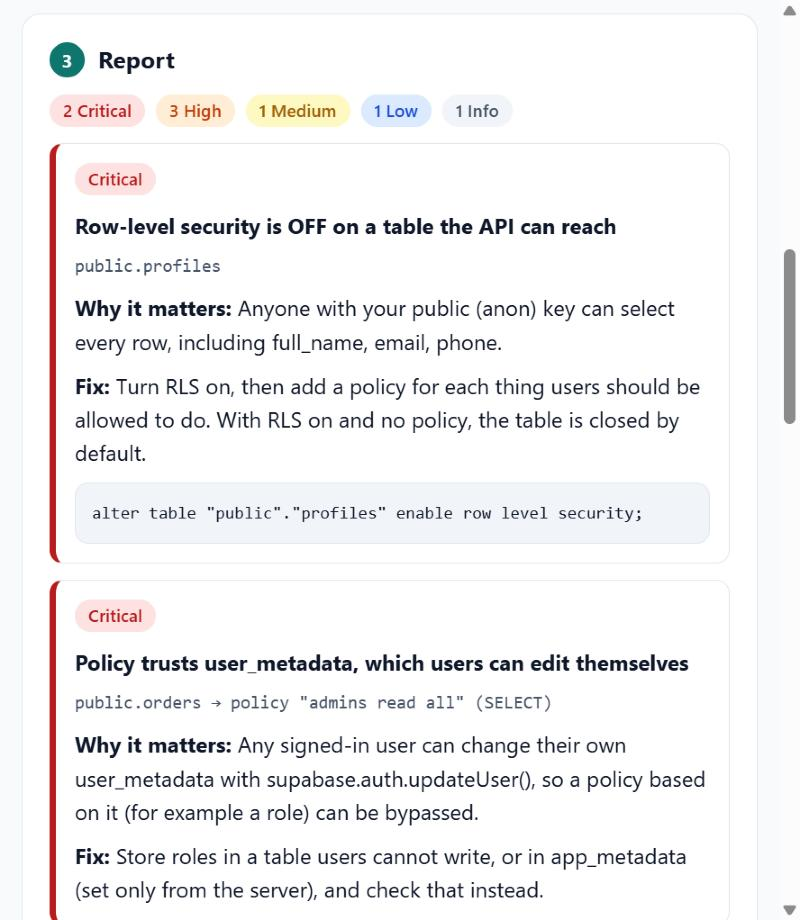

# RLS Check

A free, private security review for **Supabase** projects. It reads your database's security settings
(never your data) and explains each problem in plain English, with the SQL to fix it.

**Use it in the browser:** `https://rishendra-myaka.github.io/supabase-rls-check/` (after first deploy)



## How it works

1. Copy the read-only query ([`src/snapshot.sql`](src/snapshot.sql)) into **Supabase → SQL Editor** and run it.
   It reads `pg_class`, `pg_policies`, `information_schema.role_table_grants`, `pg_proc` and `storage.buckets`.
   It does not read rows from your tables and changes nothing.
2. Paste the single JSON value it returns into the page (or pass it to the CLI).
3. Get a report sorted from critical to info. The analysis runs entirely in your browser; nothing is uploaded.

## What it checks

| Check | Severity |
| --- | --- |
| RLS **off** on a table that `anon` / `authenticated` can reach (and which personal-looking columns are exposed) | critical / high |
| Policies that **trust `user_metadata`** (users can edit it themselves with `auth.updateUser()`) | critical |
| Write policies whose condition is always `true` (anyone can change anyone's rows) | critical / high |
| **Views** the API can read without `security_invoker` (they skip RLS); materialized views | high / medium |
| `SECURITY DEFINER` functions **without a fixed `search_path`** | high / medium |
| `SECURITY DEFINER` functions callable by `anon` (read-only ones are info) | medium / info |
| Public reads of tables with personal-looking columns (flagged for review, not as an alarm) | medium / low |
| `auth.uid()` / `auth.jwt()` evaluated per row instead of `(select auth.uid())` (performance) | low |
| API roles holding `TRUNCATE` (ignores RLS; not reachable via the Data API) | low |
| RLS on but no policies (closed table, check it is intended); RLS off on an unreachable table | info / low |
| Public storage buckets | info |

Trigger and event-trigger functions are skipped, because they cannot be called through the API.

## Command line / CI

```bash
node src/cli.ts snapshot.json                 # Markdown report
node src/cli.ts snapshot.json --fail-on high  # exit code 1 if anything high or critical
```

Use it in a pipeline to stop a migration that opens a table by mistake.

## Tested on a real project

[`test/fixtures/book-a-slot.json`](test/fixtures/book-a-slot.json) is a snapshot from a real Supabase project
([Book a Slot](https://github.com/rishendra-myaka/expo-supabase-booking)). The first run found that Supabase's
default privileges had given `anon` and `authenticated` `TRUNCATE`, `REFERENCES` and `TRIGGER` on every table,
and that was fixed with a migration. The remaining two items are deliberate (a public business directory and a
public read-only availability function), and the tests lock that in.

## Development

```bash
npm install
npm run dev        # web page
npm test           # 14 unit tests (Node's built-in runner)
npm run typecheck
npm run build      # static site in dist/
```

## Limits

- It checks the `public` schema (the one the Data API exposes by default). Edit `exposed` in the query to add more.
- It reads policy text, so it catches common mistakes, not every possible logic error. Treat it as a review aid,
  not a security guarantee.
- Not affiliated with Supabase.

## Licence

MIT © 2026 Rishendra Myaka
